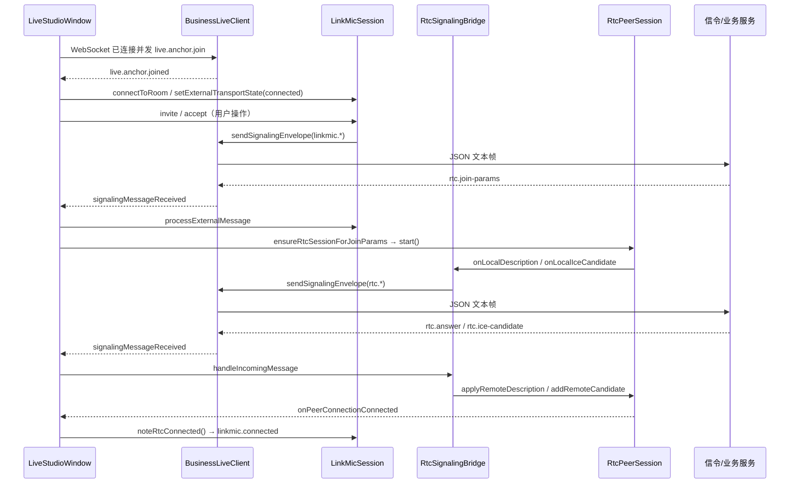

# 连麦、信令与 RTC 媒体链路说明（中文）

本文档面向本仓库 **Windows 主播端 Qt 面板（`live_studio_panel`）** 与核心库 **`live_studio_core`**，说明从进程启动到跨房连麦建连、经 WebSocket 交换 SDP/ICE、再到 **libdatachannel** 发送音视频 Track 的完整调用关系。
**RTP 解包、NAL 重组等实现细节从略**（按需求不展开）。

---

## 1. 程序入口与模块边界

### 1.1 可执行入口

- **主播面板**：`apps/live_studio_panel/main.cpp`
  - 初始化 `QApplication`、默认日志（`live_studio::logging::initializeDefaultLogger`）。
  - 构造并显示 `LiveStudioWindow`，进入 `app.exec()` 事件循环。

```9:30:apps/live_studio_panel/main.cpp
int main(int argc, char** argv) {
    QApplication app(argc, argv);
    // ...
    LiveStudioWindow window;
    window.show();
    const int exitCode = app.exec();
    // ...
    return exitCode;
}
```

- **连麦/信令探针（可选构建）**：`apps/rtc_probe/main.cpp`、`apps/rtc_guest_probe/main.cpp`
  - 使用 `apps/rtc_probe_common/SignalProbeApp.cpp` 等，**单独连一条 WebSocket** 做 `probe.register` 与完整业务+RTC 演练；与面板共用 `live_studio_core` 中的采集/Opus 等能力，但**不经过** `BusinessLiveClient`。

### 1.2 核心库职责（`live_studio_core`）

- **RTMP 主链路**：`LiveSessionController` → Worker 线程里采集、编码、FLV、RTMP（与连麦并行存在，面板里可同时「推流 + 连麦」）。
- **连麦业务状态**：`src/linkmic/LinkMicSession`、`LinkMicRoomState`、`RoomMemberDirectory`。
- **RTC 媒体与 libdatachannel 封装**：`src/rtc/RtcPeerSession`、`RtcSignalingBridge`、`RtcRemoteAudioSink` / `RtcRemoteVideoSink`。

---

## 2. 面板启动后：UI 与业务 WebSocket 的绑定

`LiveStudioWindow` 构造函数中完成几件与连麦强相关的事情：

1. 创建 `BusinessLiveClient`（业务 HTTP + 业务 WebSocket）。
2. 配置 `LinkMicSession`：
   - `setUseExternalTransport(true)`：**连麦 JSON 不单独再起一条「连麦专用 WS」**，而是复用业务 WS 发送/接收。
   - `setExternalMessageSender(...)`：真正发 JSON 时调用 `BusinessLiveClient::sendSignalingEnvelope`。
3. 配置 `RtcPeerSession` 回调：本地 SDP/ICE → `RtcSignalingBridge`；连接成功 → `linkMicSession_.noteRtcConnected()`；远端视频帧 → 预览控件。
4. 配置 `RtcSignalingBridge` 回调：远端 SDP/ICE → `rtcPeerSession_.applyRemoteDescription` / `addRemoteCandidate`。
5. 连接 `BusinessLiveClient::signalingMessageReceived` → `handleBusinessSignalingMessage`。

业务状态每次变化时，`handleBusinessStateChanged()` 会刷新快照并调用 **`syncLinkMicTransportFromBusiness()`**，从而把「是否已登录、房间 key、信令 URL、WS 是否已 join 房间」同步给 `LinkMicSession`（见下文）。

---

## 3. 信令是如何「创建」的：两层概念

### 3.1 业务层信令（主播进房、成员列表等）

由 **`BusinessLiveClient`** 维护一条 **`QWebSocket`**（与 HTTP API 同一业务域，路径一般为 `/ws`，由 `deriveSignalingUrl` 从 API Base 推导）。

典型顺序（概念上）：

1. HTTP 登录/建房间等（`beginStartSequence` 流程内）。
2. WebSocket `open` 后发送 **`live.anchor.join`**，等待服务端 **`live.anchor.joined`**。
3. 之后服务端可推送 **`room.member-list` / `room.member-join` / `room.member-leave`** 等；其中带 `roomKey` 的成员类消息会在客户端里 **再 `emit signalingMessageReceived`**，供连麦模块消费。

连麦/RTC 类消息（`type` 为 `signal.error`、`linkmic.*`、`rtc.*`）在 `handleSocketTextMessage` 中识别后，**直接** `emit signalingMessageReceived(object)`，不再走房间成员的特殊分支。

### 3.2 连麦业务信令（跨房邀请、接受、join-params）

由 **`LinkMicSession`** 在已连上的传输层上，发送 **统一信封** JSON（`buildEnvelope`）：

- 顶层字段包含：`type`、`sessionId`/`session_id`、`fromRoomKey`/`toRoomKey`、`fromUserId`/`toUserId`、`requestId`、`payload`、`tsMs` 等（与 probe 文档中的 envelope 概念一致）。
- 业务类型包括：`linkmic.invite`、`linkmic.accept`、`linkmic.reject`、`linkmic.cancel`、`linkmic.hangup`、以及成功后的 **`linkmic.connected`** 等。

**面板当前策略**：`usesExternalTransport() == true` 时，`connectToRoom` **不会**调用 `LinkMicSignalingClient::connectToServer`，只把 `LinkMicSession` 绑定到「业务 WS 已就绪」这一事实上，并通过 `setExternalTransportState` 反映连接态。

### 3.3 独立 WebSocket 连麦客户端（代码中存在，面板默认不用）

**`LinkMicSignalingClient`** 内部是另一条 **`QWebSocket`**：

- `connectToServer` → `socket_.open(signalingUrl)`。
- `connected` 后发送 **`probe.register`**（`role: anchor`, `mode: signal`），等待服务端 **`probe.registered`**。
- 文本帧 JSON 经 `textMessageReceived` 解析后交给 `LinkMicSession::handleIncomingMessage`。

该路径适合 **probe 或与业务 WS 分离的部署**；**`live_studio_panel` 默认走业务 WS**，因此多数联调场景下你看到的是 `BusinessLiveClient` 而不是 `LinkMicSignalingClient` 在收发连麦消息。

---

## 4. 如何用 Socket（WebSocket）做信令通信

### 4.1 发送路径（面板）

| 用途 | 调用链 |
|------|--------|
| 连麦业务 envelope | `LinkMicSession::sendEnvelope` → `externalMessageSender_` → **`BusinessLiveClient::sendSignalingEnvelope`** → `sendSocketJsonMessage`（`QWebSocket::sendTextMessage`） |
| RTC SDP/ICE envelope | `RtcSignalingBridge::sendLocalDescription` / `sendLocalIceCandidate` → 同样的 **`sendSignalingEnvelope`** |

`sendSignalingEnvelope` 若不在对象线程，会用 **`Qt::BlockingQueuedConnection`** 切回 `BusinessLiveClient` 线程再发送，避免跨线程直接碰 `QWebSocket`。

### 4.2 接收路径（面板）

`BusinessLiveClient::handleSocketTextMessage` 解析 JSON → 按 `type` 分发 → 对 `linkmic.*` / `rtc.*` 等 **`emit signalingMessageReceived(object)`**。

`LiveStudioWindow::handleBusinessSignalingMessage`：

1. **`linkMicSession_.processExternalMessage(message)`**
   驱动 `LinkMicSession` 状态机（邀请、接受、`rtc.join-params` 等）。
2. **`rtcSignalingBridge_.handleIncomingMessage(message)`**（若 bridge 已 `start`）
   过滤 `sessionId`/房间/用户是否与当前 RTC 会话匹配，匹配则解析 **`rtc.offer` / `rtc.answer` / `rtc.ice-candidate`**，回调到 `RtcPeerSession`。
3. 若 `type == "rtc.join-params"`，在消息已进入 `LinkMicSession` 更新 `roomState` 后，调用 **`ensureRtcSessionForJoinParams()`** 启动或重启本端 `RtcPeerSession` + `RtcSignalingBridge`。

---

## 5. 连麦业务流程（业务态 → RTC 态）

### 5.1 状态机职责划分

- **`LinkMicRoomState`**：维护跨房会话的「信令阶段」——空闲、等待对方响应、来电、等待 `rtc.join-params`、RTC 连接中/已连接、结束等；并生成/校验 `sessionId`、`requestId`、`rtcRole` 等。
- **`LinkMicSession`**：
  - 收发上述 envelope；
  - 维护 **`RoomMemberDirectory`**（来自 `room.member-*`）；
  - 请求超时 **`QTimer`**（如等待 `rtc.join-params`）；
  - 在收到 **`rtc.join-params`** 时解析 **`RtcJoinParams`**（ICE、角色、房间 key、用户 id 等）。

### 5.2 典型成功路径（概念序列）

以下两端对称描述；**服务端负责转发与生成 `rtc.join-params`**（本仓库不包含 Go 服务端实现，仅客户端消费该消息）。

1. **主播 A 与业务 WS 就绪**
   `syncLinkMicTransportFromBusiness` 在具备 `userId`、`roomKey`、`signalingUrl` 且配置变化时调用 `linkMicSession_.connectToRoom`；在收到 `live.anchor.joined` 后 `setExternalTransportState(connected, ...)`，`LinkMicSession` 视为可发连麦业务消息。

2. **邀请**
   A 调用 `LinkMicSession::invite(targetRoomKey, targetUserId)` → 发送 `linkmic.invite` envelope。

3. **对端接受**
   B 收到 `linkmic.invite` → 用户操作 `accept()` → `linkmic.accept`。
   A 侧收到 `linkmic.accept` 后进入等待 **`rtc.join-params`** 的状态（`startRequestTimer`）。

4. **服务端下发 `rtc.join-params`**
   载荷中带 `sessionId`、`rtc_role`（offerer/answerer）、`iceServers`、双方 room/user 等。
   `LinkMicSession::handleIncomingMessage` 内 `parseJoinParams` → `roomState_.handleJoinParams(...)`。

5. **面板侧启动 RTC**
   `handleBusinessSignalingMessage` 发现 `type == "rtc.join-params"` → **`ensureRtcSessionForJoinParams()`**：
   - 从 `LiveSessionController` 取当前采集配置、码率、是否在 preview 等，组装 **`RtcSessionConfig`**；
   - **`rtcSignalingBridge_.start(config, sender)`**；
   - **`rtcPeerSession_.start(config)`** → 内部创建 **`rtc::PeerConnection`**、添加收发 Track、（offerer 时）创建 DataChannel 等；
   - 若配置 `preferExternalCapture`（通常 preview 在跑时为 true），**`configureRtcCaptureTap(true)`** 把预览同一采集复用到 RTC（见第 7 节）。

6. **WebRTC 建连**
   libdatachannel 在添加 Track / DataChannel 后会触发 **`onLocalDescription` / `onLocalCandidate`** → `RtcSignalingBridge` 封装为 **`rtc.offer` / `rtc.answer` / `rtc.ice-candidate`** 经业务 WS 发往对端；对端 SDP/ICE 经 `handleIncomingMessage` 回到 **`applyRemoteDescription` / `addRemoteCandidate`**。

7. **传输连通**
   `PeerConnection::State::Connected` 时 **`RtcPeerSession`** 触发 **`onPeerConnectionConnected`** → 面板里 **`linkMicSession_.noteRtcConnected()`**，发送 **`linkmic.connected`** envelope，便于服务端/对端记录「RTC 已通」。



### 5.3 结束与清理

`linkmic.reject` / `linkmic.cancel` / `linkmic.hangup` / `linkmic.kick` 在 `handleBusinessSignalingMessage` 中会 **`stopRtcSession`**，停止 bridge、关闭 `RtcPeerSession`、关闭采集 tap；`LinkMicSession` 内也会更新 `roomState` 并清理计时器。

---

## 6. 从「项目启动」到「成功发送 Track」：RTC 媒体路径

### 6.1 `RtcPeerSession::start` 之后发生什么

1. **`createPeerConnection()`**
   - 读取 `RtcSessionConfig::iceServers` 填入 **`rtc::Configuration`**。
   - 注册 **`RtcpReceivingSession`** + 解包器（Opus/H.264）在 **入站 Track** 上；远端编码帧进入 **`RtcRemoteAudioSink` / `RtcRemoteVideoSink`**（解码、回调 UI 或落盘）。
   - 添加入站 **RecvOnly** 音频/视频 **Track**（固定 payload type：Opus `111`，H.264 `102`）。
   - 若 `enableAudioSend` / `enableVideoSend`：添加 **SendOnly** Track，挂上 **RTP 打包链**（含 **`RtcpSrReporter`**、**`RtcpNackResponder`**，见第 8 节），并启动 **音频/视频发送线程**。
   - 若未使用「外部 tap 采集」且本机设备可用：配置 **`LiveDeviceCaptureSource`** 并起 **capture 线程** 读帧后 `pushLocalVideoFrame` / `pushLocalAudioFrame`。
   - **`maybeCreateOutboundDataChannel()`**：仅当 **`rtcRole` 为 offerer** 时创建 **`cross-room-linkmic`** DataChannel，用于 ping/pong 与轻量控制；**媒体仍走 RTP Track**。

2. **本地 SDP / ICE**
   由 libdatachannel 在合适的时机触发已注册的 **`onLocalDescription` / `onLocalCandidate`**，经 **`RtcSignalingBridge`** 发到服务端。

3. **发送媒体**
   - **视频**：发送线程从队列取 **`media::VideoFrame`** → FFmpeg **`VideoEncoder`** 编 H.264 → **`outboundVideoTrack->sendFrame(...)`**（带时间戳）。
   - **音频**：Opus **`OpusAudioEncoder`** → **`outboundAudioTrack->sendFrame`**。
   - 队列有上限（如视频 8 帧、音频 128 帧），满则丢最旧帧，属于**应用侧轻量平滑**，与 RTP 层抖动缓冲不同。

### 6.2 面板如何喂给 RTC：与 `LiveSessionController` 的关系

- **`configureRtcCaptureTap(true)`** 时：`LiveSessionController::setMediaTapCallbacks` 把 **预览/发布链路里已经拿到的** 音视频帧副本推到 **`rtcPeerSession_.pushLocalVideoFrame` / `pushLocalAudioFrame`**。
- **`preferExternalCapture`** 来自 `ensureRtcSessionForJoinParams`：`diagnostics.previewRunning` 为 true 时优先走 tap，避免 RTC 再独占打开一套设备。
- 若未 preview 或未启用 tap，则由 **`RtcPeerSession`** 内部 **`captureThreadMain`** 单独 **`captureSource.start()`** 采集。

---

## 7. RTMP 主链路入口（与连麦并列）

与连麦无关但同属「从启动到发媒体」的另一条线是：

- `LiveStudioWindow` 在用户确认开播后调用 **`LiveSessionController::open`** → **`startPreview`** / **`startPublish`**（实现在 `LiveSessionControllerWorker` 等内部文件）。
- 编码后的 FLV 经 **`RtmpPublisher`** 推到 SRS/RTMP。

连麦使用 **WebRTC + libdatachannel**，与 RTMP **独立**；面板可同时运行两条媒体出口。

---

## 8. 抖动与丢包：本仓库中的「逻辑边界」

本仓库 **未自研 RTP 抖动缓冲或 NACK 状态机**；相关行为主要在 **libdatachannel** 提供的 RTP/RTCP 组件中完成。代码侧可见的「策略钩子」如下。

### 8.1 接收方向（远端 → 本机）

- 入站 Track 上 **`std::make_shared<rtc::RtcpReceivingSession>()`** 与 **`chainMediaHandler`**。
- 该类在 libdatachannel 中负责与 **RTCP 反馈、接收路径上的媒体处理** 协同；**重排序、抗抖动、与解码器的衔接** 由库内部实现，应用层只处理 **`onFrame`** 给出的已关联时间戳的编码帧（之后交给 `RtcRemote*Sink` 做解码）。

### 8.2 发送方向（本机 → 远端）：对 NACK 的响应

- 出站音频/视频在 **`OpusRtpPacketizer` / `H264RtpPacketizer`** 链后追加 **`rtc::RtcpNackResponder`**。
- 含义：**当对端通过 RTCP 反馈丢失的 RTP 序号时，本端在库允许的范围内重发对应 RTP**，从而改善丢包下的主观质量；**是否发送 NACK、拥塞控制** 仍主要由对端与网络条件决定。

### 8.3 应用层与库层的分界

- ** bounded 队列丢帧**：发送线程前的队列满时丢弃旧帧，避免编码/发送线程无限积压。
- **关键帧请求**：入站视频 Track **`onOpen`** 时调用 **`requestKeyframe()`**，利于订阅方在卡顿或首帧阶段尽快拿到可解码图像。

---

## 9. 与 `rtc_probe` 的差异（便于对照阅读）

| 项目 | `live_studio_panel` | `rtc_probe` / `rtc_guest_probe` |
|------|---------------------|----------------------------------|
| 信令 Socket | **业务 `BusinessLiveClient` 单条 WS** | **`SignalProbeApp` 内独立 WebSocket**（`rtc::WebSocket`） |
| 注册消息 | 业务 `live.anchor.join` 等 | **`probe.register`** |
| 连麦状态机 | **`LinkMicSession` + `LinkMicRoomState`** | **`SignalProbeSession`**（概念对应） |
| RTC 封装 | **`RtcPeerSession` + `RtcSignalingBridge`** | 逻辑内嵌在 **`SignalProbeApp.cpp`** |

若需对照消息字段与超时行为，可继续阅读 `docs/technical_architecture.md` 第 5 节与 `docs/guest_link_mic_plan_libdatachannel.md`。

---

## 10. 关键源文件索引

| 主题 | 路径 |
|------|------|
| 面板入口 | `apps/live_studio_panel/main.cpp` |
| UI 与连麦/RTC 编排 | `apps/live_studio_panel/LiveStudioWindow.cpp` |
| 业务 WebSocket | `apps/live_studio_panel/BusinessLiveClient.cpp` |
| 连麦会话与 envelope | `src/linkmic/LinkMicSession.cpp` |
| 可选独立连麦 WS | `src/linkmic/LinkMicSignalingClient.cpp` |
| 房间/邀请状态 | `src/linkmic/LinkMicRoomState.cpp` |
| RTC 媒体与 PeerConnection | `src/rtc/RtcPeerSession.cpp` |
| SDP/ICE 与 JSON 映射 | `src/rtc/RtcSignalingBridge.cpp` |
| RTMP 会话控制 | `src/session/LiveSessionController*.cpp` |
| 探针信令+RTC | `apps/rtc_probe_common/SignalProbeApp.cpp` |

---

*文档生成自当前仓库源码结构；服务端消息名与字段以实际 Go 服务为准，客户端已同时兼容部分 snake_case 与 camelCase 字段名。*
